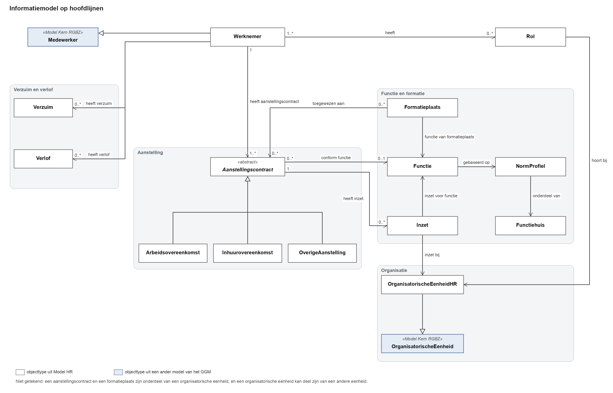

# Informatiemodel op hoofdlijnen

Het informatiemodel van deze specificatie is het deel van Model HR van het [Gemeentelijk Gegevensmodel](https://www.gemeentelijkgegevensmodel.nl/) (GGM) dat voor het Verzuimportaal nodig is. Deze pagina schetst het model op hoofdlijnen. Alle objecttypen, kenmerken, relaties en waardelijsten staan in de [detailspecificatie](definities/Detail_Model HR.md).

!!! warning "Gebaseerd op een wijzigingsvoorstel"
    Het model volgt het wijzigingsvoorstel *Uitbreiding HR-domein: aanstelling, inzet en verzuim* voor het GGM (versie 0.5, november 2026). Dat voorstel voegt de wensen van het Verzuimportaal samen met die van Venster voor Bedrijfsvoering. Het is nog niet aangenomen; het model kan dus nog wijzigen.

## Hoofdindeling

Het model heeft vier delen.

**Aanstelling.** Een **Werknemer** verricht werkzaamheden voor de organisatie op grond van een **Aanstellingscontract**. Dat is een abstract objecttype met drie subtypen: de **Arbeidsovereenkomst** voor eigen personeel, de **Inhuurovereenkomst** voor externe krachten en de **OverigeAanstelling** voor stagiairs, werkervaringsplaatsen en overige vormen. De aanstellingssoort geeft binnen elk subtype de precieze vorm. Het begin, het einde en de uren per week gelden voor alle drie; de schaal, de contractsoort en de cao bestaan alleen bij een arbeidsovereenkomst.

**Functie en formatie.** Een contract leidt tot **Inzet**: de inzet van de werknemer voor een **Functie** bij een organisatorische eenheid, in een bepaalde periode. Opeenvolgende inzetten vormen de functie- en afdelingshistorie. Een functie kan zijn gebaseerd op een **NormProfiel** uit een **Functiehuis**, voor gemeenten HR21. Een **Formatieplaats** is de toegestane omvang voor een functie bij een eenheid; zij bestaat ook als zij onbezet is.

**Organisatie.** Een **OrganisatorischeEenheidHR** is een onderdeel van de organisatie: het concern, een directie, een afdeling of een team. Een eenheid kan deel zijn van een andere eenheid; zo ontstaat de organisatiestructuur. Een **Rol** legt vast wie in welke periode leiding geeft aan welke eenheid.

**Verzuim en verlof.** **Verzuim** is een aaneengesloten periode waarin een werknemer de overeengekomen arbeid geheel of gedeeltelijk niet verricht, anders dan door verlof. Een verzuimgeval heeft een percentage arbeidsongeschiktheid, een verzuimsoort en, als het is afgesloten, een reden van het einde. De medische oorzaak maakt geen deel uit van het model. **Verlof** heeft een verlofsoort volgens de Wet arbeid en zorg en de cao.

## Verband met de rest van het GGM

Werknemer is in het GGM een specialisatie van Medewerker, en OrganisatorischeEenheidHR van OrganisatorischeEenheid; beide komen uit het Model Kern RGBZ. De kenmerken die een leverancier daarvan nodig heeft, staan in de detailspecificatie bij het objecttype zelf, met de vermelding dat zij zijn geërfd.

Model HR bevat meer dan hier is opgenomen, zoals sollicitaties, opleidingen, declaraties, beoordelingen en het individueel keuzebudget. Die delen zijn voor het Verzuimportaal niet nodig.

## Van informatiemodel naar uitwisseling

De uitwisselspecificatie neemt niet alles over en voegt een paar dingen toe:

- Van **Werknemer** worden alleen een sleutel, het geboortejaar en de geslachtsaanduiding uitgewisseld; naam, geboortedatum en woonplaats niet.
- Het abstracte **Aanstellingscontract** komt in een bericht niet voor: de drie subtypen staan elk in een eigen lijst en dragen de gezamenlijke kenmerken zelf.
- **Relaties** worden in een bericht óf genest (de inzet staat binnen het contract) óf een verwijzing met een sleutel (een contract noemt de code van de functie).
- Het bericht krijgt een **omslag**: het bericht zelf, de levering per gemeente en de aanleverende organisatie.
- De historie van het percentage arbeidsongeschiktheid wordt geleverd als **verloop** binnen het verzuimgeval.

De precieze inhoud van een bericht staat in het [JSON-schema](uitwisselspecificatie.md).
